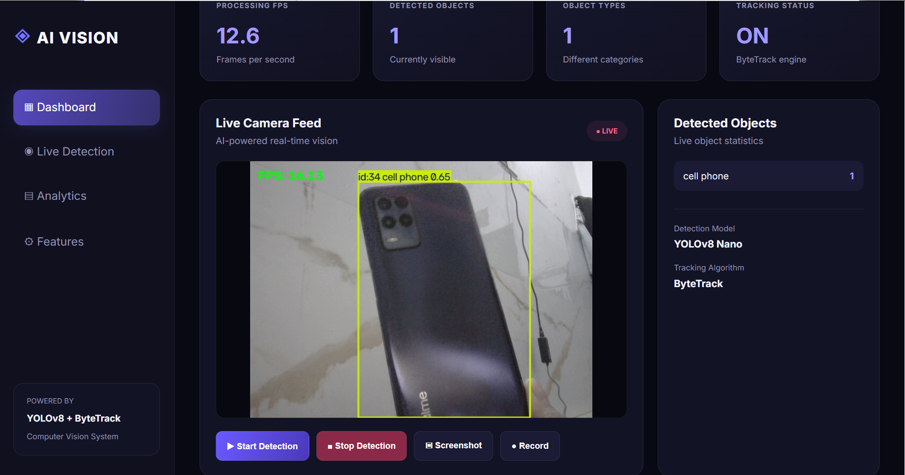
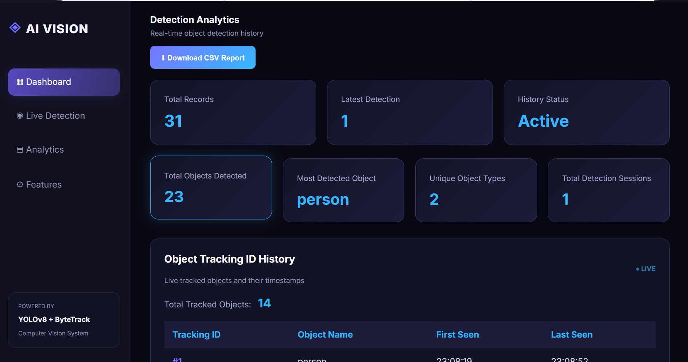

# AI Object Detection & Tracking System

An AI-powered real-time object detection and tracking application built using YOLOv8, OpenCV, ByteTrack, and Flask.

## Features

- Real-time object detection using YOLOv8
- Object tracking with unique IDs
- Live camera streaming
- Object counting and FPS monitoring
- Screenshot capture
- Video recording
- Detection analytics and summary
- Tracking ID history
- CSV analytics export
- Interactive Flask dashboard

## Technologies Used

- Python
- Flask
- YOLOv8 (Ultralytics)
- OpenCV
- ByteTrack
- HTML, CSS, JavaScript

## Installation

1. Clone the repository:

   ```bash
   git clone YOUR_GITHUB_REPOSITORY_URL
   ```

2. Open the project folder:

   ```bash
   cd Object_Detection_Tracking
   ```

3. Create a virtual environment:

   ```bash
   python -m venv venv
   ```

4. Activate the environment on Windows:

   ```powershell
   .\venv\Scripts\Activate.ps1
   ```

5. Install dependencies:

   ```bash
   pip install -r requirements.txt
   ```

6. Run the application:

   ```bash
   python app.py
   ```

7. Open in your browser:

   http://127.0.0.1:5000

## Project Structure

```text
Object_Detection_Tracking/
├── models/
├── screenshots/
├── recordings/
├── static/
│   ├── style.css
│   └── app.js
├── templates/
│   └── index.html
├── app.py
├── main.py
├── requirements.txt
└── README.md
```

## Future Improvements

- Multiple camera support
- Improved tracking accuracy
- Cloud deployment
- Advanced analytics and reports

## Project Demo Video

Watch the complete project demonstration:

[](https://youtu.be/PGg6mFISrAQ)

[Click here to watch the demo](https://youtu.be/PGg6mFISrAQ)

## Project Screenshots

### 1. Dashboard


### 2. Object Detection


### 3. Analytics Dashboard


## Author

Developed as an AI/ML project.
